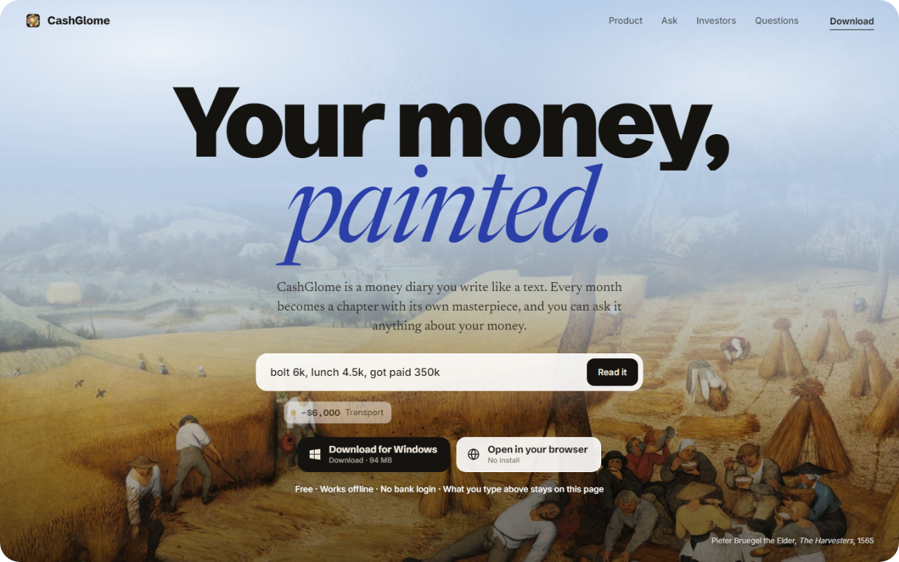
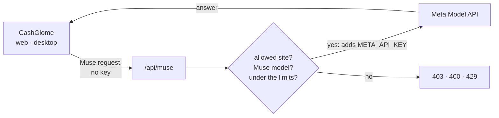

<div align="center">



<br>

# CashGlome — the website

**[cashglome.vercel.app](https://cashglome.vercel.app)** · **[Open the app →](https://cashglome.vercel.app/app/)** · [The app's repo](https://github.com/cashglome/cashglome-app)

<sub>Plain HTML, CSS and JavaScript. No framework, no build step, no trackers, no third-party requests.</sub>

</div>

<br>

This repo is three things, all deployed together by Vercel:

| Path | What it is |
|---|---|
| `/` | **The landing page.** Three painted chapters (*Write*, *See*, *Ask*) that scroll like a short film. |
| `/app/` | **The real app**, a production build of [cashglome-app](https://github.com/cashglome/cashglome-app). It's what "Open in your browser" opens. |
| `/api/muse` | **The shared Muse.** A small server function that lets everyone use Meta's Muse models on one key the browser never sees. |

<br>

## The page

Read top to bottom, it's a story in scenes:

1. **Hero.** *Your money, painted.* over Bruegel's *The Harvesters*, with a working reader: type "lunch 12, uber 9, got paid 2,400" and it's read into entries right there. It's a small copy of the app's own reader (`reader.js` plus the app's category words in `assets/categories.js`) and runs entirely in the browser; nothing typed is sent anywhere.
2. **The problem.** Why money apps get abandoned, every figure linked to its source.
3. **Three chapters.** *Write* (type, say, snap), *See* (the month as a painting you restore), *Ask* (questions answered from your own entries). Each one pins a painting while the words move over it.
4. **Everywhere.** Web, Windows, Mac, iPhone, and what's ready today.
5. **Beliefs**, **a memo for investors**, and **questions**.
6. **Finale.** The downloads. The visitor's own platform comes first.

**How the motion works.** [Lenis](https://github.com/darkroomengineering/lenis) smooths the native scroll, and GSAP ScrollTrigger maps scroll position to each scene. Pinning is plain CSS `position: sticky`, so the art never jitters. Only `transform` and `opacity` animate. With *Reduce motion* on, the page adds `.calm` and holds still. GSAP, ScrollTrigger, SplitText and Lenis are vendored in `assets/vendor/`, not loaded from a CDN.

<br>

## Run it

```bash
npx vite --port 5180
```

Or serve the folder with any static server (`python -m http.server`). `/api/muse` only runs on Vercel, or locally with `vercel dev`.

**Deploying:** push to `main` and Vercel publishes cashglome.vercel.app in about 30 seconds. Other branches get preview links.

<br>

## Before publishing

Edit `CONFIG` at the top of `main.js`:

| Field | Now | What it does |
|---|---|---|
| `contact` | `hello@cashglome.app` *(placeholder)* | The inbox for "Request the deck". |
| `web` | `app/` | Where "Open in your browser" goes: this repo's own `app/` folder. |
| `downloads` | Windows *available*; Mac, iPhone, Android *soon* | One entry per platform. Set `status: 'available'` and a `url` when a build ships. |

> [!IMPORTANT]
> The Windows installer (`downloads/CashGlome-Setup-4.0.0.exe`, 94 MB) is **not in this repo**, so the live download returns 404. The button checks first and shows a short message instead of downloading an error page. Upload the installer to a [GitHub release](https://github.com/cashglome/cashglome-app/releases) and point `downloads.windows.url` at it.

<br>

## The app at `/app/`

`app/` is a production build of [cashglome-app](https://github.com/cashglome/cashglome-app), checked in so Vercel serves it as is. The app uses relative paths throughout, so it runs from a subfolder unchanged. To update it, from a `cashglome-app` checkout next to this folder:

```bash
node scripts/publish-web.mjs
```

That reads the app's `.env.local`, prints which features are on, type-checks, and builds into `../cashglome-site/app/`. Then commit and push here.

| In the app's `.env.local` | Turns on |
|---|---|
| `VITE_SUPABASE_URL`, `VITE_SUPABASE_ANON_KEY` | Accounts and sync between devices |
| `VITE_MUSE_PROXY=https://cashglome.vercel.app/api/muse` | Muse for everyone, through the function below |

The script stops if a secret (a Meta key, a Supabase `service_role` key) is about to be built into the app, where anyone could read it.

<br>

## The shared Muse at `/api/muse`

[`api/muse.js`](api/muse.js) adds CashGlome's Meta key to the app's Muse requests and passes them to Meta's Model API. The key lives only in Vercel's environment and never reaches a browser. [`vercel.json`](vercel.json) also routes the app's own `app/__ai/…` calls here, so people who paste their own key in the app are served too, on their key.



**Vercel → Project → Settings → Environment Variables**

| Variable | Required | Default | |
|---|:---:|---|---|
| `META_API_KEY` | ✅ | | The key everyone shares. Mark it **Sensitive**. |
| `META_BASE` | | `https://api.meta.ai/v1` | OpenAI-compatible base URL. |
| `MUSE_PER_MINUTE` | | `20` | Requests a minute per visitor. |
| `MUSE_PER_DAY` | | `300` | Requests a day per visitor. |
| `MUSE_ORIGINS` | | | Extra sites allowed to call it, comma-separated. |

Redeploy after changing them.

**What it allows:**
- Only Muse models: `muse-spark-1.3`, `muse-spark-1.1`, `muse-wonder-1.0`.
- Answers of up to 4,000 tokens, and requests up to 4 MB (receipt photos).
- Calls from cashglome.vercel.app, the desktop app and local development.

The function itself logs and stores nothing; it passes the request on and the answer back.

> [!WARNING]
> The per-visitor limits are counted in memory on each server instance, so they slow people down rather than stop them. **Set a monthly spending limit on the key in Meta's console.** If it's reached, Muse calls fail and the app quietly goes back to its on-device reader.

Without `META_API_KEY`, the function answers *"The shared Muse isn't set up on this server yet"* and the app carries on without Muse.

Full setup, including Supabase: [docs/SETUP.md in cashglome-app](https://github.com/cashglome/cashglome-app/blob/main/docs/SETUP.md).

<br>

## Files

```
index.html            the page: every scene, in order
styles.css            the look: paper, ink, pigments; light and dark scenes
main.js               motion, downloads, contact links (CONFIG at the top)
reader.js             the hero's live reader (runs in the browser only)
assets/
  art/  art/lg/       the paintings (960 px; full-bleed ones also at 1800 px)
  fonts/              Newsreader, Schibsted Grotesk, Inter (self-hosted)
  shots/              screenshots of the app
  categories.js       the app's category words, for the reader
  vendor/             GSAP, ScrollTrigger, SplitText, Lenis
app/                  the web app (built from cashglome-app; don't edit by hand)
api/muse.js           the shared Muse (Vercel function)
vercel.json           routes app/__ai/* to the shared Muse
docs/hero.png         the picture at the top of this README
scripts/
  prepare-assets.cjs  copies paintings, fonts, icon and screenshots from cashglome-app
  readme-shot.cjs     renders docs/hero.png from the live site
```

**Refreshing `assets/`** from a `cashglome-app` checkout (with `npm install` done):

```bash
npx electron ../cashglome-site/scripts/prepare-assets.cjs <folder-of-app-screenshots>
```

**Refreshing the picture at the top** (Electron from the app checkout works):

```bash
npx electron scripts/readme-shot.cjs
```

<br>

## Facts on the page

Every statistic links to its source. The answers shown in *Ask* are real answers from the app's built-in example month. **Don't add user numbers or traction until they're real.**

<br>

## Credits

- **Paintings:** all public domain, from Wikimedia Commons. The hero is Pieter Bruegel the Elder, *The Harvesters* (1565, The Met).
- **Motion:** [GSAP](https://gsap.com) with ScrollTrigger and SplitText, under the [GSAP Standard License](https://gsap.com/standard-license). [Lenis](https://github.com/darkroomengineering/lenis), MIT (`assets/vendor/LICENSE-lenis.txt`).
- **Type:** Newsreader, Schibsted Grotesk and Inter, all under the SIL Open Font License.

<div align="center">
<br>
<sub><i>CashGlome gives general money insights, not licensed financial advice.</i></sub>
<br><br>

</div>
